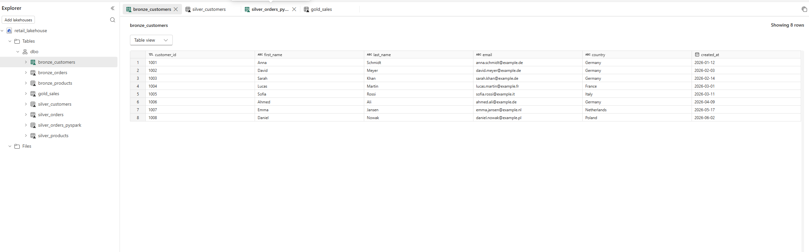

# Retail Data Engineering with Microsoft Fabric

End-to-end retail data engineering portfolio project built with **Microsoft Fabric**, demonstrating data ingestion, Medallion Architecture, PySpark transformations, Delta Lake, pipeline orchestration, dimensional modeling, SQL analytics, Direct Lake semantic modeling, DAX, and Power BI reporting.

---

## Project Overview

This project simulates a modern retail data platform that integrates data from multiple business domains:

* **Customers / CRM**
* **Orders / Webshop**
* **Products / ERP**

The goal is to build an end-to-end data engineering workflow in Microsoft Fabric:

**ingest → validate → transform → orchestrate → model → analyze → visualize**

The project was developed as a practical **Data Engineering portfolio project** and as hands-on preparation for the **Microsoft Fabric Data Engineer Associate (DP-700)** certification.

---

## Architecture

The platform follows a Medallion-style architecture:

```text
CSV Sources
    ↓
Dataflow Gen2
    ↓
Bronze Layer
    ↓
Silver Layer
    ├── Dataflow Gen2
    └── PySpark
    ↓
Gold Sales
    ↓
Fabric Warehouse
    ↓
Star Schema
    ↓
Direct Lake Semantic Model
    ↓
SQL / DAX Analytics
    ↓
Power BI Dashboard
```

A detailed architecture diagram is available here:

[View Architecture](docs/architecture.md)

---

## Technology Stack

| Area                        | Technologies                        |
| --------------------------- | ----------------------------------- |
| Platform                    | Microsoft Fabric                    |
| Storage                     | Fabric Lakehouse / OneLake          |
| Ingestion                   | Dataflow Gen2                       |
| Transformation              | Power Query, PySpark                |
| Processing                  | Apache Spark                        |
| Storage Format              | Delta Lake                          |
| Orchestration               | Fabric Data Pipelines               |
| Warehouse                   | Fabric Warehouse                    |
| Analytics                   | T-SQL, DAX                          |
| Data Modeling               | Medallion Architecture, Star Schema |
| Semantic Layer              | Direct Lake Semantic Model          |
| Visualization               | Power BI                            |
| Version Control / Portfolio | GitHub                              |

---

# Data Architecture

## Bronze Layer

Raw source data is ingested into the Fabric Lakehouse using **Dataflow Gen2**.

Tables:

* `bronze_customers`
* `bronze_orders`
* `bronze_products`

The Bronze layer intentionally remains close to the source structure and acts as the raw ingestion layer.

### Lakehouse



---

## Silver Layer

The Silver layer contains cleaned, validated, and standardized data.

Implemented transformations include:

* datatype validation
* NULL checks
* duplicate detection
* duplicate removal
* text normalization
* business-rule validation
* standardized customer and product information

Tables:

* `silver_customers`
* `silver_orders`
* `silver_orders_pyspark`
* `silver_products`

The Orders transformation was implemented using both **Dataflow Gen2** and **PySpark**.

This allowed the low-code and code-based approaches to be compared and validated against each other.

The resulting datasets produced equivalent results.

---

# PySpark Transformation

The project contains a code-based Silver transformation:

[`notebooks/nb_transform_orders_silver.ipynb`](notebooks/nb_transform_orders_silver.ipynb)

The notebook performs:

* reading `bronze_orders` from the Lakehouse
* NULL validation
* duplicate detection
* business-rule validation
* filtering invalid records
* deduplication
* writing a Delta table
* validating the PySpark output against Dataflow Gen2

Example transformation:

```python
df_orders_silver = (
    df_orders
    .filter(col("order_id").isNotNull())
    .filter(col("customer_id").isNotNull())
    .filter(col("product_id").isNotNull())
    .filter(col("quantity") > 0)
    .dropDuplicates(["order_id"])
)
```

The resulting table is written to:

```text
silver_orders_pyspark
```

### PySpark Notebook


---

# Data Quality

Data quality checks were implemented before writing data into the Silver layer.

Examples:

```text
order_id IS NOT NULL
customer_id IS NOT NULL
product_id IS NOT NULL
quantity > 0
order_id must be unique
```

Additional validation was performed by comparing the Dataflow Gen2 and PySpark implementations.

Both implementations returned:

```text
Row count: identical
Rows only in Dataflow: 0
Rows only in PySpark: 0
```

This verified that both transformation approaches produced equivalent results.

---

# Gold Layer

The Gold layer combines cleaned Customer, Product, and Order data into the business-ready dataset:

```text
gold_sales
```

The table contains attributes including:

* order ID
* customer ID
* customer name
* country
* product ID
* product name
* category
* quantity
* unit price
* sales amount
* order date

A business metric is calculated during transformation:

```text
sales_amount = quantity × unit_price
```

---

# Pipeline Orchestration

The Fabric pipeline:

```text
pl_retail_medallion
```

orchestrates the complete workflow.

Customer, product, and order ingestion can execute independently before downstream transformations are triggered.

The production Orders path uses the PySpark notebook:

```text
ingest_orders
      ↓
transform_orders_pyspark
      ↓
build_gold_sales
```

The pipeline demonstrates:

* activity dependencies
* parallel execution
* success conditions
* Dataflow Gen2 integration
* Notebook integration
* Bronze → Silver → Gold orchestration
* pipeline monitoring
* end-to-end execution

### Fabric Pipeline


---

# Fabric Warehouse

A Fabric Warehouse was created as the analytical serving layer:

```text
retail_warehouse
```

The Gold data is transformed into a dimensional **Star Schema**.

## Dimension Tables

* `dim_customer`
* `dim_product`
* `dim_date`

## Fact Table

* `fact_sales`

Conceptually:

```text
                 dim_customer
                       |
                       |
dim_product —— fact_sales —— dim_date
```

The SQL used to create the dimensional model is available here:

[`sql/create_star_schema.sql`](sql/create_star_schema.sql)

---

# Star Schema

The analytical model separates descriptive business attributes from measurable events.

### `dim_customer`

Contains customer-related attributes such as:

* customer ID
* customer name
* country

### `dim_product`

Contains:

* product ID
* product name
* category
* unit price

### `dim_date`

Contains:

* order date
* year
* month
* day
* month name

### `fact_sales`

Contains:

* order ID
* customer ID
* product ID
* order date
* quantity
* unit price
* sales amount

### Warehouse / Semantic Model


Relationships follow a standard one-to-many model:

```text
dim_customer (1) ──── (*) fact_sales
dim_product  (1) ──── (*) fact_sales
dim_date     (1) ──── (*) fact_sales
```

Single-direction filtering is used from the dimension tables toward the fact table.

---

# SQL Analytics

Analytical SQL queries are stored in:

[`sql/analytics_queries.sql`](sql/analytics_queries.sql)

The queries answer business questions including:

* Which country generates the most revenue?
* Which products generate the highest sales?
* Which product categories perform best?
* How does revenue develop over time?
* Which customers generate the most revenue?

Example:

```sql
SELECT
    c.country,
    SUM(f.sales_amount) AS total_revenue
FROM dbo.fact_sales AS f
JOIN dbo.dim_customer AS c
    ON f.customer_id = c.customer_id
GROUP BY c.country
ORDER BY total_revenue DESC;
```

---

# Direct Lake Semantic Model

A Direct Lake semantic model named:

```text
retail_sales_model
```

was created on top of the Fabric Warehouse.

The model contains:

* `fact_sales`
* `dim_customer`
* `dim_product`
* `dim_date`

This provides the semantic layer used by Power BI for analytical reporting.

---

# DAX Measures

Reusable DAX measures were created in the semantic model.

## Total Revenue

```DAX
Total Revenue =
SUM(fact_sales[sales_amount])
```

## Total Orders

```DAX
Total Orders =
DISTINCTCOUNT(fact_sales[order_id])
```

## Average Order Value

```DAX
Average Order Value =
DIVIDE([Total Revenue], [Total Orders])
```

These measures are reused throughout the Power BI report.

---

# Power BI Dashboard

A Power BI report named:

```text
Retail Data Engineering - Sales Dashboard
```

was created using the Direct Lake semantic model.

The dashboard includes:

### KPI Cards

* Total Revenue
* Total Orders
* Average Order Value

### Analytical Visuals

* Revenue by Country
* Revenue by Product
* Revenue by Category
* Revenue over Time
* Top Customers by Revenue

### Final Dashboard


The reporting layer demonstrates how the engineered data platform can support business analytics after ingestion, transformation, modeling, and orchestration are complete.

---

# Repository Structure

```text
retail-data-engineering-fabric/
│
├── README.md
│
├── data/
│   ├── customers.csv
│   ├── orders.csv
│   └── products.csv
│
├── notebooks/
│   └── nb_transform_orders_silver.ipynb
│
├── sql/
│   ├── create_star_schema.sql
│   └── analytics_queries.sql
│
├── docs/
│   └── architecture.md
│
└── screenshots/
    ├── Data Visualization.png
    ├── Fabric pipeline.png
    ├── Lakehouse.png
    ├── Pyspark notebook.png
    └── warehouse schema.png
```

---

# Engineering Concepts Demonstrated

This project demonstrates practical experience with:

### Data Engineering

* ETL / ELT
* data ingestion
* data transformation
* data cleansing
* data validation
* data quality
* pipeline orchestration

### Microsoft Fabric

* OneLake
* Fabric Lakehouse
* Dataflow Gen2
* Fabric Data Pipelines
* Fabric Notebooks
* Fabric Warehouse
* Direct Lake

### Data Architecture

* Medallion Architecture
* Bronze / Silver / Gold layers
* Star Schema
* Fact and Dimension tables
* dimensional modeling

### Programming & Querying

* PySpark
* Apache Spark
* Power Query
* T-SQL
* DAX

### Analytics

* semantic modeling
* business measures
* Power BI
* KPI reporting
* analytical visualization

### Engineering Practices

* low-code vs code-based transformations
* validation between implementations
* dependency management
* debugging
* troubleshooting
* reproducible SQL scripts
* GitHub project documentation

---

# End-to-End Data Flow

The completed project demonstrates the following workflow:

```text
Customers / Orders / Products
            ↓
        CSV Sources
            ↓
      Dataflow Gen2
            ↓
     Bronze Lakehouse
            ↓
   Data Cleaning & Validation
            ↓
 Dataflow Gen2 / PySpark
            ↓
        Silver Layer
            ↓
      Business Joins
            ↓
         Gold Sales
            ↓
     Fabric Warehouse
            ↓
        Star Schema
            ↓
  Direct Lake Semantic Model
            ↓
      DAX Measures
            ↓
       Power BI Report
```

---

# Example Business Questions

The resulting platform can answer questions such as:

* Which countries generate the most revenue?
* Which products generate the highest revenue?
* Which product categories perform best?
* How does revenue change over time?
* Which customers contribute the most revenue?
* What is the average order value?
* How many distinct orders were processed?

---

# Future Improvements

Possible future extensions include:

* incremental data loading
* larger synthetic datasets
* parameterized pipelines
* automated data-quality reporting
* improved error handling
* pipeline alerts and monitoring
* CI/CD
* Git-based deployment workflows
* Infrastructure as Code
* streaming ingestion
* Microsoft Fabric Real-Time Intelligence
* Eventhouse
* KQL analytics

---

# Key Learning Outcomes

Through this project I practiced how individual Data Engineering technologies fit together as one platform rather than learning them in isolation.

The project covers the complete path from:

```text
Raw Data
→ Ingestion
→ Lakehouse
→ Transformation
→ Data Quality
→ PySpark
→ Orchestration
→ Warehouse
→ Dimensional Modeling
→ Semantic Modeling
→ Analytics
→ Visualization
```

---

# About This Project

This project was developed as a hands-on **Data Engineering portfolio project** while preparing for the **Microsoft Fabric Data Engineer Associate (DP-700)** certification.

The focus was not only on learning individual Microsoft Fabric features, but on understanding how ingestion, transformation, orchestration, storage, data quality, dimensional modeling, semantic modeling, analytics, and visualization work together in an end-to-end data platform.
